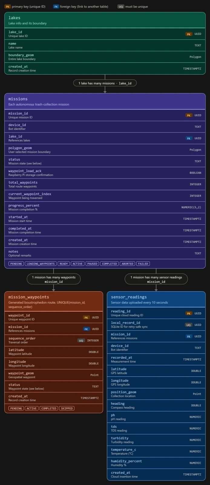

# Shared Supabase schema

The dashboard (frontend) and the Raspberry Pi backend use **one** Supabase schema,
with exactly these table and column names. Both repositories must follow it; neither
side adds, renames or drops a table or column on its own.

- Diagram: [`images/supabase-schema.webp`](images/supabase-schema.webp)
- SQL (source of truth): [`../supabase/schema.sql`](../supabase/schema.sql), the
  same file in both repositories
- Robot API and live telemetry: [`robot-protocol.md`](robot-protocol.md)

## Tables

| Table | Columns |
|---|---|
| `lakes` | `lake_id` (PK, uuid), `name`, `boundary_geom` (Polygon), `created_at` |
| `missions` | `mission_id` (PK, uuid), `device_id`, `lake_id` (FK → lakes), `polygon_geom` (Polygon), `status`, `waypoint_load_ack` (boolean), `total_waypoints`, `current_waypoint_index`, `progress_percent` (numeric 5,2), `started_at`, `completed_at`, `created_at`, `notes` |
| `mission_waypoints` | `waypoint_id` (PK, uuid), `mission_id` (FK → missions), `sequence_order`, `latitude`, `longitude`, `waypoint_geom` (Point), `status`, `created_at`; unique (`mission_id`, `sequence_order`) |
| `sensor_readings` | `reading_id` (PK, uuid), `local_record_id` (unique, uuid), `mission_id` (FK → missions), `device_id`, `recorded_at`, `latitude`, `longitude`, `position_geom` (Point), `heading`, `ph`, `tds`, `turbidity`, `temperature_c`, `humidity_percent`, `created_at` |

Status values:

- `missions.status`: `PENDING`, `LOADING_WAYPOINTS`, `READY`, `ACTIVE`, `PAUSED`, `COMPLETED`, `ABORTED`, `FAILED`
- `mission_waypoints.status`: `PENDING`, `ACTIVE`, `COMPLETED`, `SKIPPED`

All geometry is SRID 4326 (WGS 84), written as EWKT, e.g.
`SRID=4326;POINT(77.48698 12.91686)` (longitude first). All times are UTC.

## Who writes what

| Step | Who | Writes |
|---|---|---|
| Plan created | Dashboard | `lakes` row (`name`, `boundary_geom`); `missions` row: new `mission_id`, `device_id`, `lake_id`, `polygon_geom`, `status = PENDING`, `waypoint_load_ack = false`, `total_waypoints`, `progress_percent = 0`; one `mission_waypoints` row per waypoint (`sequence_order` 0 = GCS, last = GCS, `status = PENDING`) |
| Plan sent to the Pi | Dashboard | `missions.status = LOADING_WAYPOINTS` |
| Waypoints stored in SQLite | Pi | `missions.waypoint_load_ack = true`, `status = READY` |
| Plan refused / not stored | Dashboard | `missions.status = FAILED`, reason in `notes` |
| Mission started / paused / resumed | Pi | `status = ACTIVE` / `PAUSED` / `ACTIVE`; `started_at` when first `ACTIVE` |
| Heading to waypoint *n* | Pi | `missions.current_waypoint_index = n`, `progress_percent`; that waypoint's `status = ACTIVE` |
| Waypoint reached | Pi | that `mission_waypoints.status = COMPLETED` (or `SKIPPED` if passed over) |
| Every 10 s while running | Pi | one `sensor_readings` row (new `reading_id`, `local_record_id` = the SQLite record id, upsert on `local_record_id` so retries never duplicate) |
| Finished at the GCS | Pi | `status = COMPLETED`, `completed_at`, `progress_percent = 100` |
| Abort / emergency stop | Pi | `status = ABORTED`, `completed_at`, reason in `notes` |

`mission_id` is always the uuid the dashboard generated and sent in the mission payload;
the Pi never invents its own. `device_id` is `BOT001` unless configured otherwise.

## Rules

1. Table and column names are exactly as above, in lower case. No aliases
   (`lat`/`lon`, `heading_deg`, `turb`, `waypoint_index`, … are not used in Supabase).
2. The Pi uses the service-role key, kept only on the Pi. The dashboard uses the
   publishable key. Neither key is committed to a repository.
3. A schema change is a pull request in **both** repositories that updates
   `supabase/schema.sql` and this document, merged together.
4. Live telemetry (every 2 s) is not stored in Supabase; it goes over the Pi's
   WebSocket (`robot-protocol.md`, section 3).
